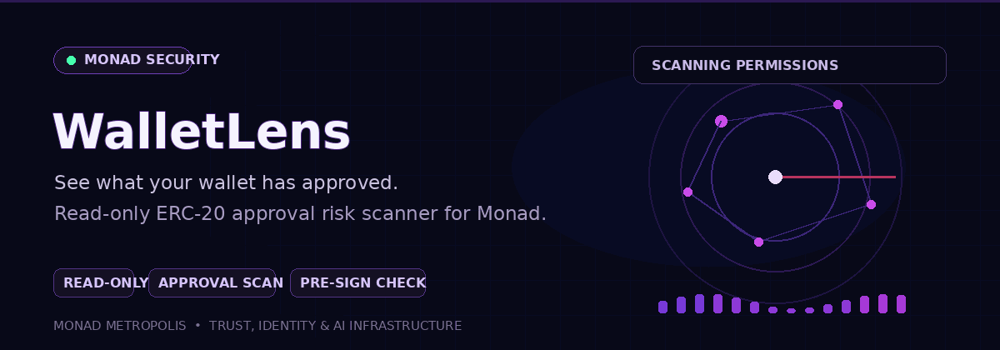

<div align="center">
  

  <p><strong>See what your wallet has approved.</strong></p>
  <p>Read-only ERC-20 approval risk scanner for Monad.</p>

  <p>
    <a href="#what-it-does">Features</a> ·
    <a href="#how-it-works">How it works</a> ·
    <a href="#run-locally">Run locally</a>
  </p>
</div>


# WalletLens

Read-only token approval scanner and pre-sign check API for Monad.

**Live:** https://YOUR-URL  |  **API docs:** https://YOUR-URL/developers

## The problem
Every token approval is a permission that stays open until revoked. On Monad, wallets and dApps have no simple way to ask "who can spend this user's tokens, and should this new approval worry us?" WalletLens answers both, with a link to the on-chain transaction behind every finding.

## What it does
- **Scan** (`GET /api/v1/scan/{address}`): reads the wallet's full ERC-20 approval history from Envio HyperSync, keeps only active approvals, groups unlimited allowances by spender, and returns structured findings (id, severity, title, description, evidence, source, confidence, limitations).
- **Check** (`GET /api/v1/check?spender=0x..&unlimited=true`): a pre-sign check an app can call before asking a user to approve a spender.
- **Dashboard** (`/`): human-readable report, same data.

Risk levels are categories, not scores. **High** means an unlimited approval to a plain wallet (an address with no contract code). Unlimited approval to a contract is "worth reviewing", because trading apps commonly request it.

## How it works
1. Validate the address.
2. Query Envio HyperSync for Approval events where the wallet is the owner.
3. Keep the latest allowance per token and spender; drop revoked ones.
4. Check spenders with `eth_getCode` on Monad RPC.
5. Return findings. An explanation is written from the verified findings only (never from raw on-chain text, so token names cannot inject instructions).

## Run locally
```
python -m venv .venv
.venv\Scripts\activate
pip install -r requirements.txt
copy .env.example .env      # fill in values; never commit .env
uvicorn server:app --reload
```
Environment variables are listed in `.env.example`. `ENVIO_API_TOKEN` is a free token from envio.dev.

## Deploy (Render)
Build: `pip install -r requirements.txt`. Start: `uvicorn server:app --host 0.0.0.0 --port $PORT`. Set the environment variables in the dashboard, not in code.

## Security
Keys stay server-side. Strict address validation, per-IP rate limits, request timeouts, 5-minute cache, no application-level storage of addresses (note: the GET API puts the address in the URL, so your host's access logs will record it), Content-Security-Policy with no inline scripts or styles, all untrusted text rendered with `textContent`. The API is read-only and never asks for keys, seed phrases or signatures.

## Limitations (please read)
- ERC-20 approvals only. No token reputation, known-malicious lists, NFT approvals, balances or transaction history.
- "No findings" never means "safe".
- The Envio free plan is rate limited and shared by all users. If the indexer fails, the app falls back to the public RPC, which only sees recent blocks, so that scan covers far less history.
- The per-IP limit trusts `X-Forwarded-For` and can be spoofed.
- Tests cover validation and rules; provider-failure paths are only partly tested.

## Built for
Monad Metropolis hackathon, track: Trust, Identity & AI Infrastructure. Uses Envio HyperSync for the core data layer.
